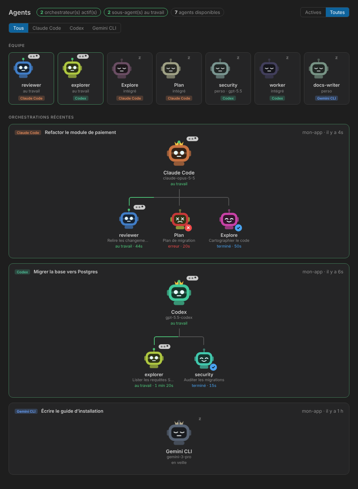

# Agents Viewer

**A supervision dashboard for your AI coding agents, inside VS Code.**

When several agents work in parallel — an orchestrator delegating to sub-agents, in several projects, with different tools — it gets hard to know who is doing what. Agents Viewer gives you one place to see it:

- **What agents do I have?** A catalogue of every custom and built-in agent, per tool.
- **What is running right now?** Every orchestrator session and the sub-agents it spawned, with live status and durations.
- **Across all my tools.** Claude Code, OpenAI Codex CLI and Gemini CLI in a single view, including sessions started outside VS Code.
- **Without risk.** Read-only, fully local, no network, no telemetry.

> Independent community project, not affiliated with Anthropic, OpenAI or Google.
> The UI is currently in French; English localization is on the roadmap.



## Features

- **Graph view** — a live org chart per session: the orchestrator on top, the sub-agents it spawned below, with status and running timers. Each agent is drawn as a small avatar whose expression tells its state at a glance (working, idle, done, error, interrupted). Filter by tool and by active/recent sessions.
- **Available agents** — custom and built-in agents of every detected tool, with model and how many instances are running.
- **Orchestrators & sub-agents tree** — every recent session of every tool, with its sub-agents and their status.
- **Status bar** — `Agents : 1 orch. · 2 sous-agents` when something is running; click to open the graph view.

Tools that aren't installed are simply ignored.

## Supported tools

| Tool | Agents read from | Sessions read from | Sub-agents |
|---|---|---|---|
| Claude Code | `~/.claude/agents/*.md`, `.claude/agents/*.md` + built-ins | `~/.claude/projects/<path>/<session>.jsonl` | `Task` / `Agent` tool calls |
| Codex CLI | `~/.codex/agents/*.toml`, `.codex/agents/*.toml` + built-ins | `~/.codex/sessions/YYYY/MM/DD/rollout-*.jsonl` | child sessions (`parent_thread_id`), else `spawn_agent` calls |
| Gemini CLI | `~/.gemini/agents/*.md`, `.gemini/agents/*.md` | `~/.gemini/tmp/<project>/chats/session-*.json(l)` | not yet |

`$CLAUDE_CONFIG_DIR` and `$CODEX_HOME` are honored; every folder can be overridden in the settings.

**Status detection is a heuristic.** A session is "running" if its files were written within `activeThresholdSeconds`; a sub-agent is "running" while its call has no result (or its own session is still being written). None of these transcript formats is a public API, so a tool update can break detection — please open an issue with a (redacted!) sample if that happens.

## Privacy & security

This extension is **read-only and fully local**:

- no network access, no telemetry, no runtime dependencies, no child processes;
- it reads only the agent and session folders listed above — never credentials (`~/.claude/.credentials.json`, `~/.codex/auth.json`, `~/.gemini/oauth_creds.json`…), settings or `.env` files;
- the graph webview runs under a strict Content Security Policy (no remote content, local nonce-guarded script only) and can only open transcripts already listed.

Transcripts contain whatever was typed in a session. The extension keeps only session titles (first 120 characters of your first message), model names and sub-agent types/descriptions, and shows them only in your own VS Code window.

## Settings

| Key | Default | Purpose |
|---|---|---|
| `agentViewer.providers` | all | tools to watch: `claude`, `codex`, `gemini` |
| `agentViewer.claude.dir` / `codex.dir` / `gemini.dir` | _(auto)_ | custom data folders |
| `agentViewer.scope` | `workspace` | `workspace` or `all` projects (globe button) |
| `agentViewer.activeThresholdSeconds` | `30` | inactivity delay before a session is idle |
| `agentViewer.recentHours` | `24` | time window of listed sessions |
| `agentViewer.pollIntervalSeconds` | `3` | auto-refresh interval |

## Roadmap

- Skills and MCP servers available to each agent, and which ones a session used
- Token usage and duration per session and per sub-agent
- Notifications when an orchestrator finishes or a sub-agent fails
- Session history and search
- English UI
- More tools (Cursor, Aider, opencode, Copilot CLI…) — contributions welcome

## Adding a provider

Each tool is one file in `src/providers/` implementing a small interface (`isInstalled`, `listAgents`, `listSessions`). Copy `gemini.ts` as a starting point, register it in `src/providers/index.ts`, and add fake data for it in `src/test/smoke.ts`. See [CONTRIBUTING.md](CONTRIBUTING.md).

## Development

```bash
npm install
npm test          # compile + smoke test on fake ~/.claude, ~/.codex, ~/.gemini
# press F5 in VS Code to launch an Extension Development Host
npm run package   # build the .vsix
```

## License

[MIT](LICENSE) © lecuistotduweb
